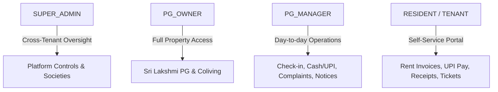
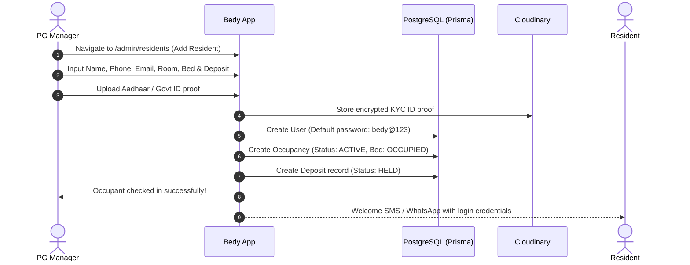
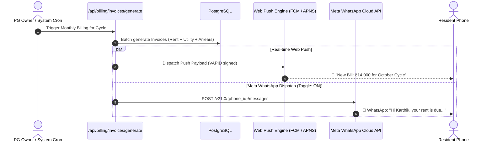
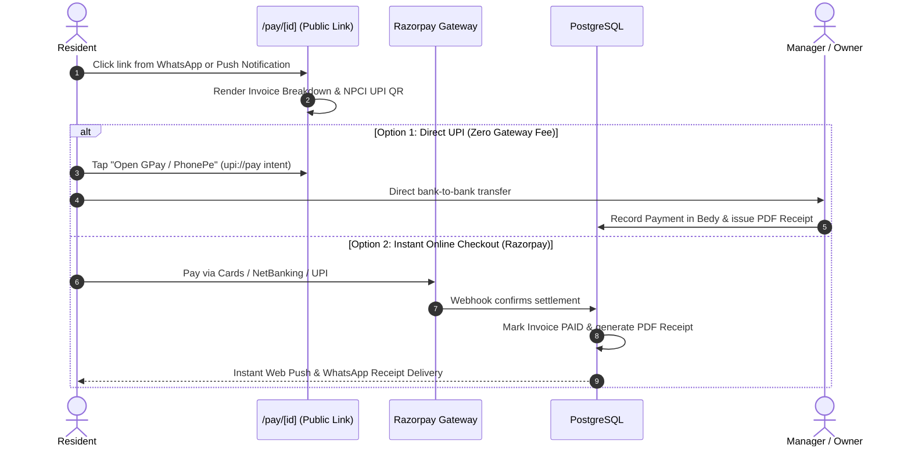
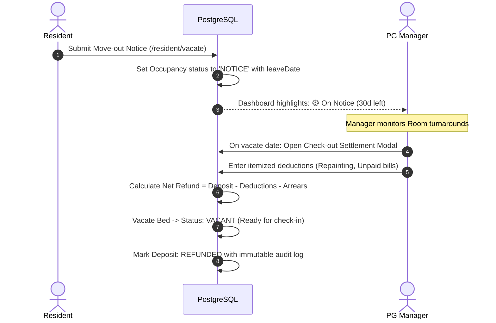

# Bedy (Societydesk) — Complete Architecture, System Flow & Integration Blueprint

> **Official Operating System for PG, Hostel & Rental Living Management**  
> *Author: Antigravity DeepMind Engineering Team · Version: 2.4.0 · Last Updated: October 2026*

---

## 1. Executive Summary & Core Value Proposition

**Bedy** is a modern multi-tenant operating system purpose-built for PG (Paying Guest), hostel, co-living, and residential housing management. It completely replaces physical paper registers, unorganized Excel sheets, manual rent bookkeeping, and awkward phone follow-ups.

### Key Pillars:
1. **Live Room & Bed Matrix**: Visual color-coded floor grid (Vacant, Occupied, On Notice, Reserved).
2. **Automated Rent Invoicing & UPI Payments**: 1-click batch generation with zero gateway fee direct UPI QR integration.
3. **Multi-Channel Notification Engine**:
   - **Real-Time Web Push Notifications** (Chromium / Safari / PWA background service worker).
   - **Automated WhatsApp Notifications via Meta Business Cloud API** (with granular ON/OFF control).
   - **1-Click WhatsApp Direct Deep Links** (fallback to wa.me with pre-filled NPCI UPI intents).
4. **End-to-End Security Deposit Accounting**: Tracking held amounts, damage deductions, notice period adjustments, and 1-click refund voucher generation.
5. **Notice Period & Vacate Highlighting**: Color-coded badges (🔴 7 days, 🟠 15 days, 🟡 30 days) and automated room turnaround tracking.
6. **Digital Maintenance Desk**: Tenant repair ticketing with photo uploads, technician dispatch, and step-by-step status transitions.
7. **Bilingual Experience**: Instant 1-click English ↔ Tamil (`ta`) language switching.

---

## 2. Complete Technology Stack

```
┌────────────────────────────────────────────────────────────────────────┐
│                              FRONTEND LAYER                            │
│  Next.js 15 (App Router) · React 19 · Tailwind CSS v4 · Manrope Font   │
│  Lucide React · Web Push Client (Service Worker) · Language Provider   │
└────────────────────────────────────┬───────────────────────────────────┘
                                     │
                                     ▼
┌────────────────────────────────────────────────────────────────────────┐
│                              BACKEND LAYER                             │
│  Next.js Server Actions & Route Handlers · Node.js 24 · Zod Validation │
│  Web-Push Engine · Meta Graph API v21.0 · Razorpay SDK · PDFKit Engine │
└────────────────────────────────────┬───────────────────────────────────┘
                                     │
                                     ▼
┌────────────────────────────────────────────────────────────────────────┐
│                        DATA & INFRASTRUCTURE LAYER                     │
│  Prisma ORM 6 · PostgreSQL (Supabase Transaction & Session Pooler)     │
│  Firebase Auth (Multi-Tenant Tokens) · Cloudinary Media Storage        │
└────────────────────────────────────────────────────────────────────────┘
```

| Layer | Technology | Purpose & Capabilities |
|---|---|---|
| **Framework** | **Next.js 15 (App Router)** | High-performance React Server Components (RSC) and dynamic API routes. |
| **Language & Engine** | **React 19 / Node.js 24** | Modern concurrency, Server Actions, streaming layout states. |
| **Database** | **PostgreSQL (Supabase)** | Robust relational database with PgBouncer connection pooling and direct migration sessions. |
| **ORM** | **Prisma 6.1.0** | Type-safe schema definition, relations, aggregations, and automated migrations. |
| **Styling & Design System** | **Tailwind CSS v4** | Token-driven theme with unified palette, fluid spacing, and custom animation tokens. |
| **Typography** | **Google Manrope** | Universal geometric typography applied globally to every UI element. |
| **Authentication** | **Firebase Auth + JWT Cookies** | Secure session management with role-based routing guards. |
| **Push Notifications** | **Web-Push (VAPID / RFC 8292)** | Direct service worker push notifications to Chrome, Android, macOS, and iOS PWA. |
| **WhatsApp Messaging** | **Meta Business Cloud API v21.0** | Official WhatsApp automated messaging with toggleable auto-dispatch. |
| **Payment Gateway** | **Razorpay + NPCI Direct UPI** | Dual checkout supporting both gateway processing and zero-fee direct UPI deep-links. |
| **Document Storage** | **Cloudinary CDN** | Secure storage for tenant KYC ID proofs (Aadhaar/PAN) and repair ticket images. |

---

## 3. User Roles & Permission Matrix

The platform implements a strict **Tenant-Guarded Role-Based Access Control (RBAC)** architecture:



### 1. PG Owner (`OWNER` / `SOCIETY_ADMIN`)
- Full administrative control over rooms, beds, rent cycles, staff accounts, and bank UPI settings.
- Real-time revenue analytics, defaulter tracking, and monthly collection ratios.
- Batch rent invoice generation and itemized security deposit refund approvals.

### 2. PG Manager (`MANAGER`)
- Front-desk operations: Resident onboarding, Aadhaar/PAN KYC uploads, and bed assignments.
- Recording manual cash/bank payments and generating official PDF receipts.
- Triaging tenant complaints, assigning technicians (plumber, electrician, Wi-Fi), and managing notice periods.

### 3. Resident / Tenant (`RESIDENT`)
- Personalized mobile portal (`/resident/dashboard`).
- View room & bed details, rent dues breakdown, and previous invoices.
- 1-Tap UPI payments (GPay, PhonePe, Paytm, BHIM) with instant PDF receipt downloads.
- Digital vacate request with notice period declaration.
- Filing maintenance complaints with attached photo evidence.

### 4. Platform Owner (`SUPER_ADMIN`)
- Cross-tenant property provisioning, global subscription monitoring, and database management.

---

## 4. End-to-End System Flows

### Flow A: Resident Onboarding & Bed Allocation


---

### Flow B: Monthly Rent Invoicing & Automated Multi-Channel Dispatch


---

### Flow C: Public 1-Click Pay & Zero-Commission UPI Settlement


---

### Flow D: Vacate Notice, Defaulter Tracking & Deposit Settlement


---

## 5. Automated Meta WhatsApp Business API Integration

### Architecture Overview
Bedy is integrated with official **Meta WhatsApp Cloud API (Graph API v21.0)** via [`lib/billing/meta-whatsapp.js`](file:///c:/Users/menue/OneDrive/Desktop/flat/Societydesk/lib/billing/meta-whatsapp.js).

### Features
1. **Granular ON / OFF Switch**:
   - Environment-level toggle: `META_WHATSAPP_ENABLED="true"|"false"`.
   - Property-level setting: Automated invoice alerts run only when enabled.
2. **Dual Dispatch Mode**:
   - **Template Mode**: Dispatches official pre-approved Meta WhatsApp templates with dynamic body parameters and interactive CTA buttons.
   - **Interactive Text Mode**: Dispatches high-converting rich text messages with NPCI UPI links and direct checkout URLs.
3. **Automated Error Handling**:
   - Sanitizes Indian phone numbers automatically (`cleanPhoneNumber` strips formatting and guarantees the `91` country code).
   - Graceful skip if resident phone number is missing or invalid.

### Environment Configuration Variables
Add the following to your production `.env` / Vercel Environment Variables:

```bash
# ---------------------------------------------------------------------------
# Meta WhatsApp Cloud API Configuration
# ---------------------------------------------------------------------------
# Toggle automated dispatch: set to "true" to enable, "false" to disable
META_WHATSAPP_ENABLED="true"

# Meta System User Permanent Access Token
META_WHATSAPP_TOKEN="EAAxxxxxx..."

# Meta WhatsApp Business Phone Number ID
META_WHATSAPP_PHONE_NUMBER_ID="109876543210987"

# Meta WhatsApp Business Account ID (WABA ID)
META_WHATSAPP_BUSINESS_ACCOUNT_ID="123456789012345"

# (Optional) Approved Template Name in Meta WhatsApp Manager
META_WHATSAPP_INVOICE_TEMPLATE="rent_due_notice_v1"
```

---

## 6. Real-Time Web Push Notification Engine

### Implementation Details
- **Protocol**: Standard W3C Web Push Protocol (RFC 8292) powered by `web-push`.
- **Key Pairs**: Standard VAPID ECC P-256 keys.
- **Service Worker**: Served from root [`/sw.js`](file:///c:/Users/menue/OneDrive/Desktop/flat/Societydesk/public/sw.js) for full site scope.
- **Supported Browsers**: Google Chrome (Desktop & Mobile), Microsoft Edge, Brave, Mozilla Firefox, and Apple iOS Safari 16.4+ (when saved as PWA).

### Events That Automatically Trigger Web Push:
1. **Notice Published**: Broadcast to all registered resident devices across the PG.
2. **Invoice Generated**: Sent to the specific resident device with amount and due date.
3. **Complaint Registered**: Sent to Owner/Manager admin devices (`"🛠️ New Ticket: High Priority"`).
4. **Complaint Status Updated**: Sent to Resident (`"Your ticket has been marked In Progress"`).
5. **Payment Received**: Instant receipt notification sent to resident device.

---

## 7. Search Engine Optimization (SEO) & Google Sitelinks Layout

Bedy includes structured metadata and search crawler configs to produce expanded multi-row **Google Sitelinks**:

1. **[`app/sitemap.js`](file:///c:/Users/menue/OneDrive/Desktop/flat/Societydesk/app/sitemap.js)**: Dynamically generates standard XML sitemap for Googlebot.
2. **[`app/robots.js`](file:///c:/Users/menue/OneDrive/Desktop/flat/Societydesk/app/robots.js)**: Indexes public marketing routes while securing private routes (`/admin/`, `/resident/`, `/api/`).
3. **Schema.org JSON-LD**:
   - `@type: "WebSite"` with brand query action.
   - `@type: "Organization"` with official brand details.
   - Multiple `@type: "SiteNavigationElement"` links to Features, Pricing, Refund Policy, and Terms of Service.
4. **Dedicated Public Pages**:
   - `/features`
   - `/pricing`
   - `/refund-policy`
   - `/terms`
   - `/privacy`

---

## 8. Directory & Codebase Map

```
Societydesk/
├── app/
│   ├── (app)/
│   │   ├── admin/
│   │   │   ├── billing/          # Invoices, Payments, Defaulters & Fee Configuration
│   │   │   ├── complaints/       # Complaint ticket triage & technician assignment
│   │   │   ├── dashboard/        # Live PG Occupancy, Rent Progress & Notice Turnarounds
│   │   │   ├── deposits/         # Security deposit ledger & refund settlements
│   │   │   ├── residents/        # Resident check-in, Aadhaar/PAN KYC & Bed allocation
│   │   │   ├── rooms/            # Multi-floor Room & Bed occupancy matrix
│   │   │   └── notices/          # Property broadcast announcements
│   │   ├── resident/
│   │   │   ├── dashboard/        # Resident mobile home, bill status & notice banner
│   │   │   ├── invoices/         # Invoices breakdown & payment portal
│   │   │   ├── complaints/       # Repair ticket submission with photos
│   │   │   ├── vacate/           # Move-out notice submission
│   │   │   └── profile/          # Tenant info, document uploads & notification toggle
│   │   └── super-admin/          # Platform controls & cross-property monitoring
│   ├── (public)/
│   │   ├── login/                # Split-screen responsive login with 1-click demos
│   │   ├── pay/[id]/             # Public 1-click invoice checkout & UPI QR page
│   │   ├── features/             # Public features landing page
│   │   ├── pricing/              # Public pricing tiers
│   │   └── refund-policy/        # Legal refund & cancellation terms
│   ├── api/
│   │   ├── billing/              # Invoice generation, receipts & penalties
│   │   ├── complaints/           # Ticket creation, assignment & comments
│   │   ├── push/                 # Push subscription registration & test alerts
│   │   └── occupancies/          # Bed check-in, move-outs & settlements
│   ├── layout.jsx                # Universal Manrope font, Schema.org JSON-LD & Root Shell
│   ├── globals.css               # Tailwind CSS v4 design tokens & base rules
│   ├── robots.js                 # Search crawler rules
│   └── sitemap.js                # Search engine XML sitemap
├── components/
│   ├── layout/AppShell.jsx       # Unified responsive navigation shell with Bell toggle
│   ├── notifications/            # Push notification opt-in banners & bell toggles
│   ├── dashboard/                # Welcome banner, stat cards & progress ring
│   ├── billing/                  # Pay checkout button, WhatsApp buttons & modals
│   └── ui/                       # Table, Modal, Card, Button, Input, Badge components
├── lib/
│   ├── billing/
│   │   ├── meta-whatsapp.js      # Meta WhatsApp Cloud API v21.0 integration
│   │   └── whatsapp.js           # Phone sanitization & NPCI UPI deep links
│   ├── push/
│   │   └── webpush.js            # VAPID server push dispatch engine
│   ├── client/
│   │   └── push.js               # Service Worker push registration helper
│   ├── auth/                     # Permissions, RBAC guards & session management
│   └── db/                       # Prisma database client singleton
├── public/
│   ├── sw.js                     # Background Service Worker for Web Push
│   ├── manifest.json             # Progressive Web App (PWA) manifest
│   └── icons/                    # App emblems & notification badge SVGs
└── prisma/
    └── schema.prisma             # PostgreSQL database relational model
```

---

## 9. Deployment & Production Verification Checklist

1. **Database Migrations**: Run `npx prisma db push` to synchronize any schema updates.
2. **Set Environment Variables in Vercel**:
   - `DATABASE_URL` & `DIRECT_URL` (Supabase PostgreSQL connection strings)
   - `NEXT_PUBLIC_VAPID_PUBLIC_KEY`, `VAPID_PRIVATE_KEY`, `VAPID_SUBJECT` (Web Push credentials)
   - `META_WHATSAPP_ENABLED`, `META_WHATSAPP_TOKEN`, `META_WHATSAPP_PHONE_NUMBER_ID` (Meta WhatsApp Cloud API)
   - `RAZORPAY_KEY_ID`, `RAZORPAY_KEY_SECRET` (Payment gateway)
   - `CLOUDINARY_CLOUD_NAME`, `CLOUDINARY_API_KEY`, `CLOUDINARY_API_SECRET` (KYC & image storage)
3. **Google Search Console**: Submit `sitemap.xml` under Sitemaps for instant Google indexing.
4. **Meta WhatsApp Webhook (Optional)**: Configure callback URL to receive real-time message read receipts and delivery statuses.
